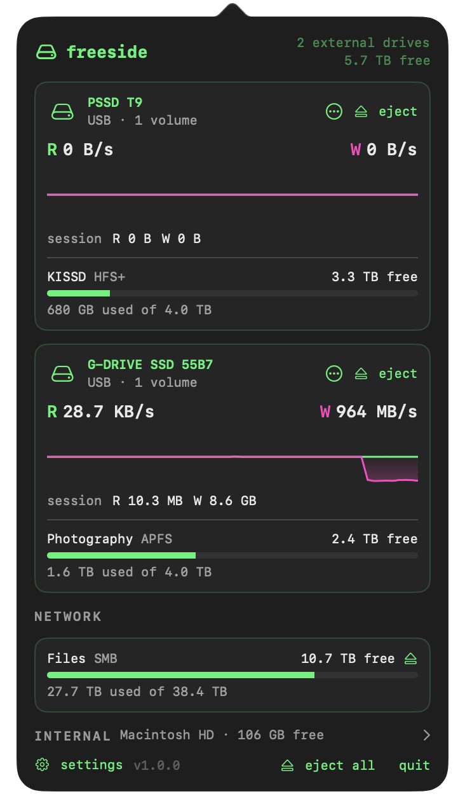

# freeside

A small menu bar app for Apple Silicon Macs that watches your drives: **free space**, **live read/write speed**, and **what's stopping a drive from ejecting**.

> "The disk wasn't ejected because one or more programs may be using it." freeside tells you which ones.

<p align="center">
  <picture>
    <source media="(prefers-color-scheme: dark)" srcset="site/screenshots/menubar-dark.png">
    
  </picture>
  <br><br>
  
</p>

freeside is a sibling to [flatline](https://github.com/banastas/flatline) and follows the same rules: one narrow job, Apple Silicon and macOS 27 only, no root helper, and close to zero cost when nothing is happening.

**Status:** 1.0. Download it from [freeside.banast.as](https://freeside.banast.as); it updates itself. The [PRD](PRD.md) lists what was checked on which hardware (§9.1) and what's measured against its budgets (§8).

## Features

- **Free space** for external drives, disk images, network shares and the internal disk, matching what Finder shows (including purgeable space on APFS)
- **Read/write speed** per physical drive, with a 60-second trace, for card offloads and project copies
- **Eject blockers**: when an eject fails, see which apps and processes are holding the drive and which files they have open, then quit them, retry, or force eject
- **Who's using this?** on any volume, without ejecting
- Menu bar shows a drive icon, free space on a pinned volume, or live activity, and switches to activity on its own while a transfer runs
- Optional notifications for low space and for a finished transfer
- Fixed-width, monochrome menu bar; terminal-style popover with a phosphor accent
- Launch at login, automatic updates via [Sparkle](https://sparkle-project.org)
- No telemetry, no root helper, no kernel extensions

freeside can only see the current user's processes. When a system process such as Spotlight or Time Machine is holding a drive, it says so and offers Force Eject.

## Requirements

- macOS 27 or later
- Apple Silicon (M1 or newer)

## Install

Download the DMG from **[freeside.banast.as](https://freeside.banast.as)**, open it, and drag freeside to Applications. It's signed and notarized, and updates itself through [Sparkle](https://sparkle-project.org).

## License

MIT. See [LICENSE](LICENSE).

## Building

Needs Xcode with the macOS 27 SDK and [XcodeGen](https://github.com/yonaskolb/XcodeGen).

```bash
xcodegen generate
open Freeside.xcodeproj
```

`swift test --package-path Packages/FreesideKit` runs the tests; some create and attach small disk images. `scripts/release.sh` builds a signed, notarized DMG in `dist/` (it needs the Developer ID certificate and notary credentials described at the top of the script; `--skip-notarize` for a signed dry run).
